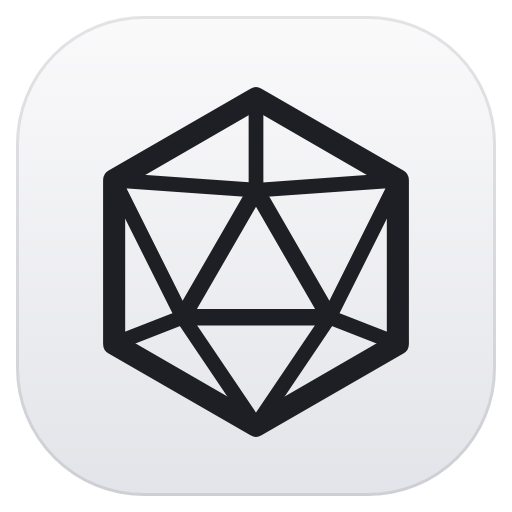
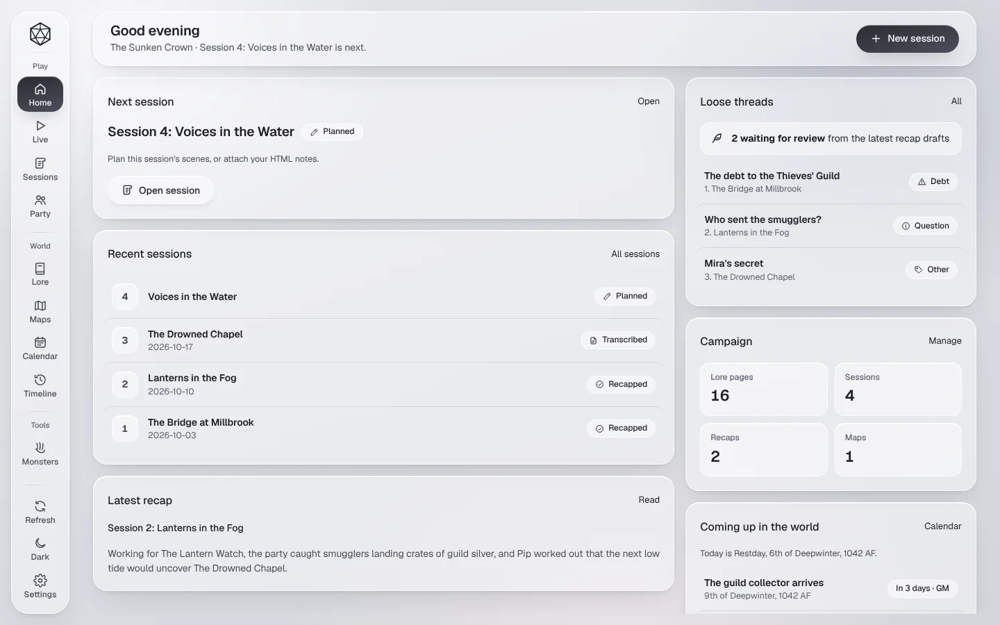
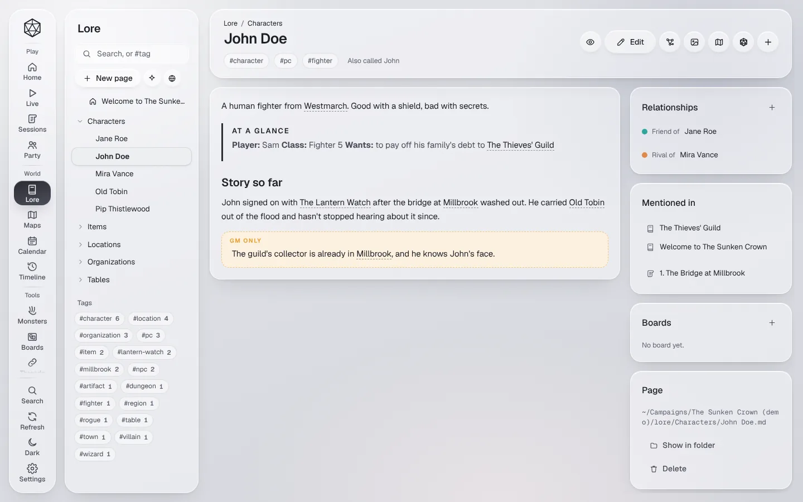
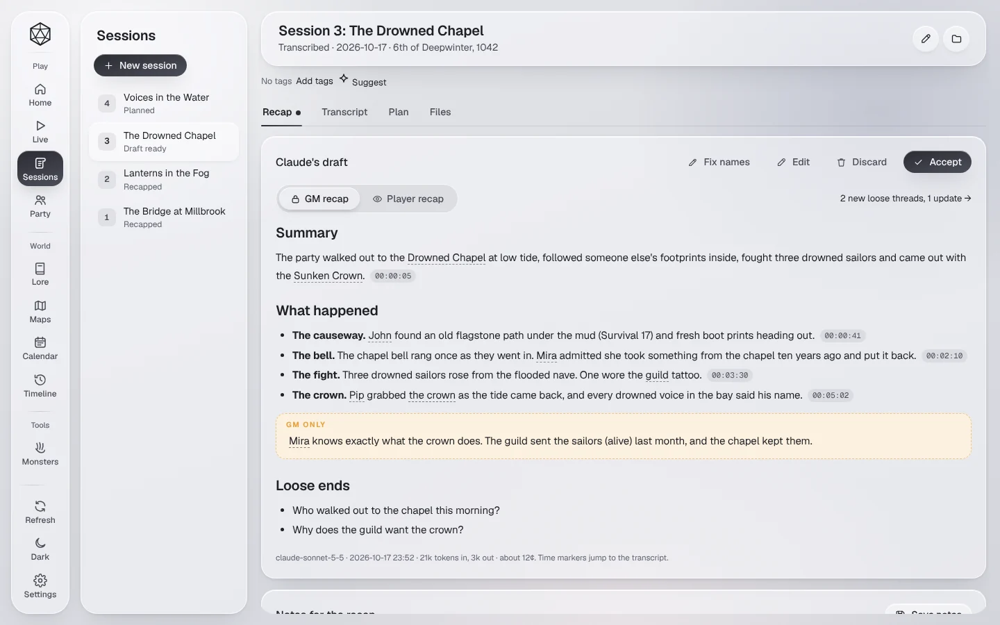
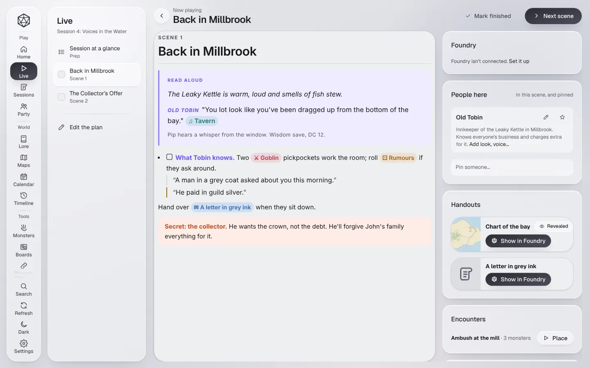
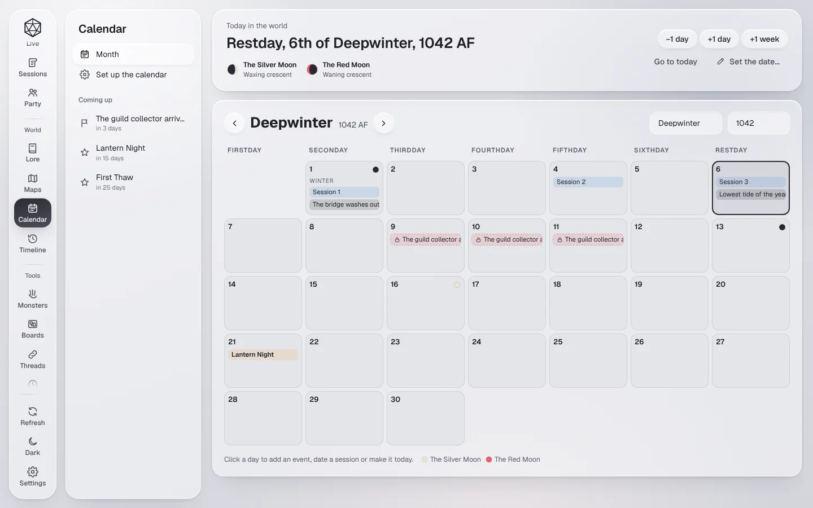

  

<h1 align="center">Lore Studio</h1>

  A friendly Windows & Linux app for game masters: keep your world's lore, plan and run sessions, 
  and turn session recordings into transcripts and recaps.

  

> **Beta.** Everything works and is tested, but expect rough edges. [Report a bug](https://github.com/cococolacake/lore-studio/issues/new/choose) if you hit one.
> New here? On the welcome screen, **Try the demo campaign** builds a small made-up campaign to click around in.

## What it does

- **Lore vault**: pages in a tree, Markdown with `[[links]]`, GM-only secrets, tags, maps with pins, and a connection graph. Imports from LegendKeeper.
- **Plan and run sessions**: write plans in Markdown, then run them one scene at a time in live mode.
- **Record to recap**: control OBS, transcribe on your own GPU with speaker labels, and have AI draft the recap and loose threads. Post recaps to Discord.
- **World tools**: an in-world calendar, timeline, faction clocks, handouts, and boards for pictures and notes.
- **Monsters and the party**: build or scale monsters, plan encounters, and fix your players' Foundry sheets.
- **Foundry VTT bridge**: send pages, handouts and monsters to Foundry, and log rolls and combat while you play.
- **Player lore book**: a website with everything your players are allowed to see.

AI is optional. Use Claude with your own API key, a model on your own computer, or switch AI off in **Settings → AI**. Your campaign is a plain folder of Markdown files, and nothing leaves your computer unless you ask. See [Privacy](docs/guide.md#privacy).

<table>
  <tr>
    <td></td>
    <td></td>
  </tr>
  <tr>
    <td></td>
    <td></td>
  </tr>
</table>

## Install

You need [Python 3.10 or newer](https://www.python.org/downloads/). On Windows, tick **Add python.exe to PATH**.

1. Download **lore-studio-&lt;version&gt;.zip** from the [latest release](https://github.com/cococolacake/lore-studio/releases/latest) and unzip it anywhere.
2. **Windows:** double-click `Install.bat`, then `Lore Studio.bat`. `Create desktop shortcut.bat` adds a desktop and Start menu shortcut.
   **Linux:** run `./install.sh`, then `./lore-studio.sh`.

To update, unzip the new release over the old folder. Your campaigns and settings are kept.

For Foundry VTT, Lore Studio installs its bridge module for you in **Settings → Foundry**.

## Learn more

The [guide](docs/guide.md) covers every feature, how your campaign folder is laid out, privacy, Foundry setup, the roadmap and development. Questions and ideas go in [Discussions](https://github.com/cococolacake/lore-studio/discussions). For bugs, [open an issue](https://github.com/cococolacake/lore-studio/issues/new/choose) and include **Settings → About → Copy diagnostics**.

## License

MIT. See [LICENSE](LICENSE).

The monsters in `studio/data/srd-monsters.json` are from the System Reference Document 5.1 ("SRD 5.1") by Wizards of the Coast LLC,
available at https://dnd.wizards.com/resources/systems-reference-document. The SRD 5.1 is licensed under the
[Creative Commons Attribution 4.0 International License](https://creativecommons.org/licenses/by/4.0/legalcode).
The data was converted from the [5e-bits/5e-database](https://github.com/5e-bits/5e-database) project (MIT).
