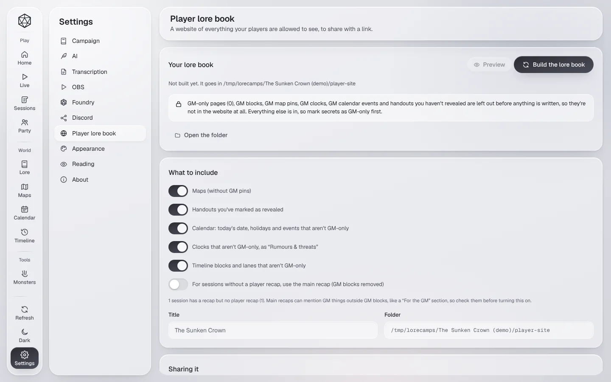
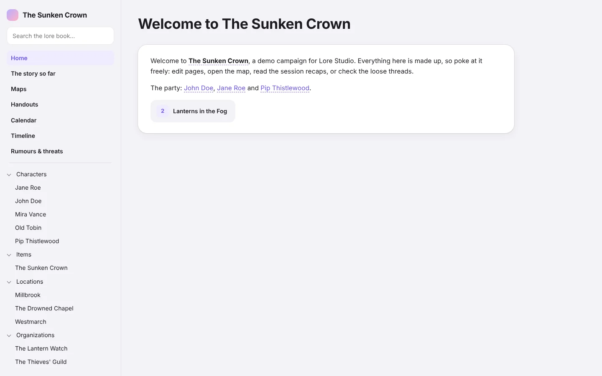

# Player lore book

- One click builds a website of everything the players are allowed to see: lore pages with their header images, player recaps, maps without GM pins, revealed handouts, the calendar and public clocks, with search and dark mode. GM-only pages, GM blocks, GM pins and secrets are removed before anything is written.
- It's a plain folder, so share it with a link through Netlify Drop, GitHub Pages or any static host, or zip it into Discord. It opens straight from disk too.

Check it before you put it online, since anything not marked GM-only is included.

<table>
  <tr>
    <td></td>
    <td></td>
  </tr>
</table>
